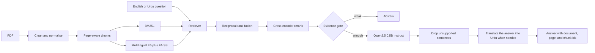
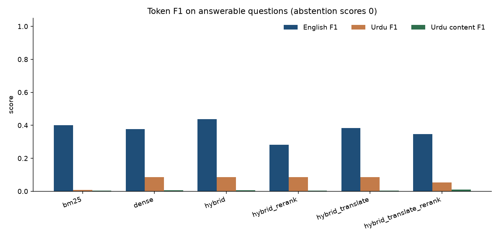
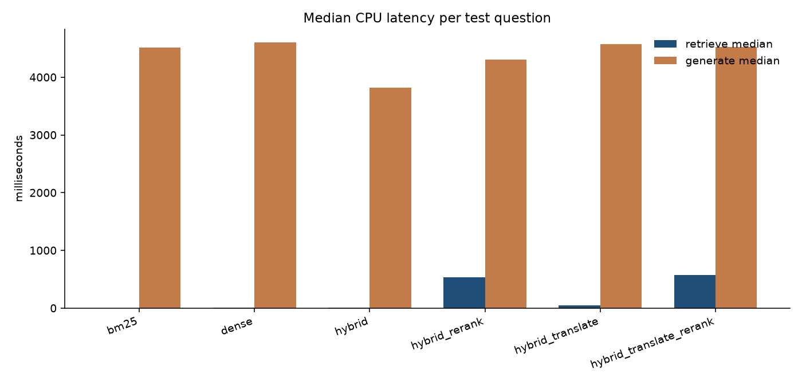

# Multilingual AI Research Assistant

Author: Shaiza Asghar ([Shaiza666](https://github.com/Shaiza666))

MIRA answers questions about research PDFs in English or Urdu. It retrieves a page-aware passage, drafts an answer with a small local instruct model, and keeps a sentence only when that passage supports it. If the evidence is weak, it says the answer is not in the indexed documents.

Everything in the default configuration runs on CPU. No API key is required. An OpenAI-compatible server can be selected with environment variables when one is available.

## What it compares

| Method | What it ranks by |
| --- | --- |
| `bm25` | BM25L keyword overlap after Urdu letter folding |
| `dense` | `intfloat/multilingual-e5-small` cosine similarity in a FAISS inner-product index |
| `hybrid` | Reciprocal rank fusion of BM25L and dense |
| `hybrid_rerank` | Fusion, then the multilingual cross-encoder `mmarco-mMiniLMv2-L12-H384` |
| `hybrid_translate` | For Urdu questions, also fuses BM25L and dense runs of an Urdu-to-English translation |
| `hybrid_translate_rerank` | The translated hybrid list, reranked |

BM25L is used instead of Okapi BM25 because Okapi's IDF is zero when a term appears in about half of a small chunk collection. Documents that contain none of the query terms still receive a zero BM25L score.

## Architecture



Urdu text is stored in Unicode NFKC so Arabic presentation forms extracted from PDFs become ordinary letters. The index folds Arabic kaf/yeh onto the Urdu letters and maps Eastern Arabic digits to ASCII. The text shown to the reader keeps the original letters aside from that compatibility normalisation.

Citations look like `[2103.14460::p1::c0]`: arXiv id, 1-based PDF page, and chunk index on that page. A sentence is kept when at least 35% of its content words occur in a retrieved chunk, or when the multilingual embedding cosine with that chunk is at least 0.82. Both thresholds were fixed before the test run. The evidence gate is separate: its score threshold is chosen on the 8-question pilot split and enabled only when it beats both 0.60 accuracy and the majority-class baseline. The pilot is not part of the reported scores.

## Benchmark

Three papers, chosen because each PDF states a CC BY 4.0 licence for the paper:

| id | paper | pages |
| --- | --- | --- |
| 2103.14460v1 | Hansen, Hansen, Simonsen, Alstrup, and Lioma. Unsupervised Multi-Index Semantic Hashing. WWW 2021. | 10 |
| 2103.14455v1 | Hansen, Hansen, Simonsen, and Lioma. Projected Hamming Dissimilarity for Bit-Level Importance Coding in Collaborative Filtering. WWW 2021. | 9 |
| 2106.16239v9 | Piotrowski, Cavalcante, and Gabor. Fixed points of nonnegative neural networks. JMLR 25 (2024). | 40 |

The test set has 32 questions: 12 English answerable questions, 12 Urdu translations of those questions, 4 English unanswerable questions, and 4 Urdu translations of the unanswerable questions. A disjoint pilot of 8 questions is used only to set the evidence gate. Urdu items are translations, not a second independently collected set, and there was no second annotator. Every answerable item stores a short quotation, and the tests check that the quotation occurs on a cited page. Details are in [data/qa/README.md](data/qa/README.md).

Retrieval metrics are macro-averages over answerable questions. Recall@k is the fraction of gold pages that appear in the top k chunks. MRR uses the chunk rank of the first gold page. nDCG@k walks the top k chunks, scores a page the first time it appears, and pads that list to length k. Answer token F1 is computed in the question language; an abstention on an answerable question scores 0. Content F1 compares the grounded English draft with the English reference, which separates retrieval-and-generation from Urdu translation. Citation page precision is the fraction of emitted citations whose page is a gold page. Raw unsupported rate is the fraction of the model's sentences that failed the support check, before those sentences were removed.

## Setup

```bash
python3 -m venv .venv
source .venv/bin/activate
pip install -U pip
pip install torch --index-url https://download.pytorch.org/whl/cpu
pip install -r requirements.txt
export PYTHONPATH=src
python scripts/download_models.py
python scripts/download_papers.py
python -m mira.cli ingest data/papers/pdf --index data/indexes/benchmark
```

`download_papers.py` refuses a PDF that does not state CC BY 4.0 or CC BY-SA 4.0. PDFs are not committed; the extracted text, the manifest, and the question files are.

## Commands

```bash
python -m mira.cli ask "What does MISH stand for?" --method hybrid_rerank
python -m mira.cli ask "MISH کس کا مخفف ہے؟" --method hybrid_rerank
python -m mira.cli evaluate --out results
pytest
streamlit run src/mira/app.py --server.port 8741
```

`make install`, `make download-models`, `make download-papers`, `make ingest`, `make evaluate`, `make test`, and `make app` wrap the same steps.

To use an OpenAI-compatible server instead of the local GGUF model:

```bash
export MIRA_LLM_BACKEND=openai
export OPENAI_BASE_URL=http://127.0.0.1:8080/v1
export OPENAI_API_KEY=local
export OPENAI_MODEL=name-served-by-that-server
```

`MIRA_LLM_BACKEND=transformers` loads `Qwen/Qwen2.5-0.5B-Instruct` in PyTorch. The default is `local-gguf`.

The Streamlit app accepts PDF uploads, answers in English or Urdu, and shows the cited chunk when a citation is selected. The second tab reads `results/` after an evaluation.

A one-page original sample note, in English and Urdu, is at `data/samples/sample-note.pdf`. It is not part of the scored benchmark.

## Measured results

The tables and charts below are copied from `results/RESULTS.md` and `results/figures/` after the command `python -m mira.cli evaluate --out results`. They are not estimates.

Hardware for this run: Intel Xeon at 2.4 GHz, 4 logical CPUs, 15.63 GiB RAM, Python 3.12.3, PyTorch 2.15.0+cpu, llama-cpp-python 0.3.37, sentence-transformers 6.3.0, FAISS 1.16.0. Device: CPU. The generator warmup in `results/RESULTS.md` is 0.4 seconds because that call was a one-line prompt and the GGUF file was already in the page cache. The timed figure is the per-question generation median, about 3.8–4.6 seconds.

Retrieval is macro-averaged over the 24 answerable test questions. Answer metrics use all 32 test questions. Abstaining on an answerable question scores 0 token F1. Exact match was 0.000 for every method: the reference answers are full sentences, and the draft rarely matches them token for token.

### Retrieval

| method | Recall@5 all | Recall@5 English | Recall@5 Urdu | MRR all | nDCG@5 all |
| --- | ---: | ---: | ---: | ---: | ---: |
| bm25 | 0.500 | 0.833 | 0.167 | 0.240 | 0.324 |
| dense | 0.750 | 0.833 | 0.667 | 0.416 | 0.506 |
| hybrid | 0.750 | 0.917 | 0.583 | 0.401 | 0.506 |
| hybrid_rerank | 0.917 | 0.917 | 0.917 | 0.724 | 0.767 |
| hybrid_translate | 0.708 | 0.917 | 0.500 | 0.497 | 0.561 |
| hybrid_translate_rerank | 0.833 | 0.917 | 0.750 | 0.679 | 0.720 |

On paraphrases, page Recall@5 was 0.500 for BM25L, 0.833 for dense retrieval, and 1.000 for hybrid plus reranking. On lexical questions it was 0.500, 0.667, and 0.833 for those three methods.


Hybrid plus reranking is the strongest retriever on this set. It is tied with the other fused methods on English Recall@5 (0.917) and is ahead on Urdu (0.917, against 0.667 for dense retrieval and 0.167 for BM25L). The Urdu questions share little vocabulary with the English pages, so keyword overlap collapses unless the question still contains an English name or a number. The multilingual encoder still ranks the supporting page, and the cross-encoder pulls that page forward: Urdu MRR rises from 0.212 for dense retrieval to 0.661 after reranking.

Urdu-to-English query translation did not improve on that. Urdu Recall@5 falls from 0.667 with the dense retriever to 0.500 when the translated query is fused in, and to 0.750 after that fused list is reranked, still below 0.917 for reranking the original question. On these questions the Marian Urdu-to-English translation is a weaker query than the Urdu question itself.

### Answers

| method | F1 all | F1 English | F1 Urdu | abstention accuracy | answerable coverage | unanswerable abstention | citation page precision | raw unsupported rate |
| --- | ---: | ---: | ---: | ---: | ---: | ---: | ---: | ---: |
| bm25 | 0.204 | 0.400 | 0.007 | 0.625 | 0.542 | 0.875 | 0.590 | 0.038 |
| dense | 0.231 | 0.376 | 0.086 | 0.875 | 0.833 | 1.000 | 0.371 | 0.025 |
| hybrid | 0.261 | 0.437 | 0.086 | 0.875 | 0.833 | 1.000 | 0.289 | 0.042 |
| hybrid_rerank | 0.184 | 0.282 | 0.086 | 0.719 | 0.625 | 1.000 | 0.144 | 0.078 |
| hybrid_translate | 0.234 | 0.383 | 0.086 | 0.750 | 0.750 | 0.750 | 0.306 | 0.037 |
| hybrid_translate_rerank | 0.200 | 0.347 | 0.053 | 0.719 | 0.708 | 0.750 | 0.216 | 0.039 |




The best retriever is not the best answerer here. Hybrid retrieval has the highest token F1 (0.261 overall, 0.437 on English). Hybrid plus reranking finds the gold page most often, but its pilot-tuned evidence gate is enabled and its answerable coverage drops to 0.625, so more answerable questions score 0 because the system abstains. Dense retrieval and hybrid retrieval abstained on every unanswerable question and still answered every English answerable question.

Urdu token F1 stays at or below 0.086. The 0.5B model often echoes the Urdu question instead of stating the fact. For `mish-ur-1` the grounded answer was `MISH کس کا مخفف ہے۔`, which restates the question, while the reference is `Multi-Index Semantic Hashing`. The embedding support rule kept that sentence because it is close to a passage about MISH, even though it does not give the expansion. Content F1 on Urdu questions, which scores the pre-translation draft against the English reference, peaks at 0.011. BM25L answers only 8.3% of answerable Urdu questions and abstains on the rest, which is why its Urdu F1 is 0.007 rather than a fluent but wrong paragraph.

English answers do contain the requested facts and also leftover mistakes. On the autoencoder question, hybrid retrieval answered that the widths were 200, 100, and 784 and cited the learning rate from a different paper. The raw draft also said the training ran for 30 epochs, and grounding dropped that sentence. Citation page precision is therefore well below retrieval recall: a correct page can be in the top five while the attached citation points at another chunk that shares a number. For Urdu the citation page precision in the table is 0.000, including cases where the cited page repeats the fact but was not the single annotated page.

Raw unsupported rate stays between 0.025 and 0.078. Most draft sentences either copy a passage or are removed. That rate is the fraction removed or marked unsupported before the answer is shown, not a claim that the shown answer is always the right fact.

### Latency

| method | retrieve median | generate median | end-to-end median | generations out of 32 |
| --- | ---: | ---: | ---: | ---: |
| bm25 | 0.8 ms | 4517.5 ms | 3634.9 ms | 20 |
| dense | 9.6 ms | 4602.5 ms | 4634.4 ms | 31 |
| hybrid | 9.7 ms | 3816.1 ms | 3844.6 ms | 32 |
| hybrid_rerank | 529.9 ms | 4304.6 ms | 4648.9 ms | 22 |
| hybrid_translate | 45.2 ms | 4573.4 ms | 2318.1 ms | 28 |
| hybrid_translate_rerank | 573.2 ms | 4525.6 ms | 5117.0 ms | 32 |



Keyword and dense retrieval are under 10 ms once the encoder is loaded. Reranking the top 20 chunks costs about 0.53 seconds. Generation is about 4–4.6 seconds median. End-to-end medians can sit below the generation median when some questions abstain before the model is called. All 192 method-question rows are in `results/predictions.jsonl`. No question raised an exception.

Full tables, including lexical and paraphrase splits, are in [results/RESULTS.md](results/RESULTS.md).

## Limitations

- The collection is three English papers and 32 test questions. Urdu questions are translations, so they are not an independent Urdu information need.
- Gold pages are the pages annotated for each fact. A later page that repeats the fact is not always listed, so a faithful citation of that later page lowers citation page precision.
- Qwen2.5 0.5B Instruct often drafts English even for an Urdu question. The Urdu wording then comes from `opus-mt-en-ur`, and token F1 against the Urdu reference is sensitive to that translation.
- The cross-encoder was trained on mMARCO, which does not include Urdu as a labelled language. Its Urdu behaviour on this set is empirical.
- The evidence gate is fit on eight pilot questions. Several methods left the gate disabled because it did not beat the majority baseline.
- BM25 cannot match an Urdu paraphrase of an English sentence unless the question still contains the English name, number, or dataset title.
- CPU latency is dominated by the 0.5B model. A larger instruct model would change answer quality and the timings.

## Further work

- Add papers that are themselves written in Urdu, with questions written in Urdu rather than translated.
- Replace the lexical support check with a small multilingual NLI model if one stays fast enough on CPU.
- Calibrate the evidence gate on a larger pilot, and report a threshold sweep without using the test labels.
- Try a 1.5B quantised instruct model and compare answer F1 at the same retrieval lists.

## Licence

The code is released under the MIT licence, copyright Shaiza Asghar. The Noto Naskh Arabic font in `src/mira/assets/fonts/` is under the SIL Open Font License 1.1. The three papers remain under CC BY 4.0; attribution is in `data/papers/MANIFEST.json`.
