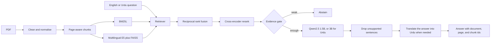
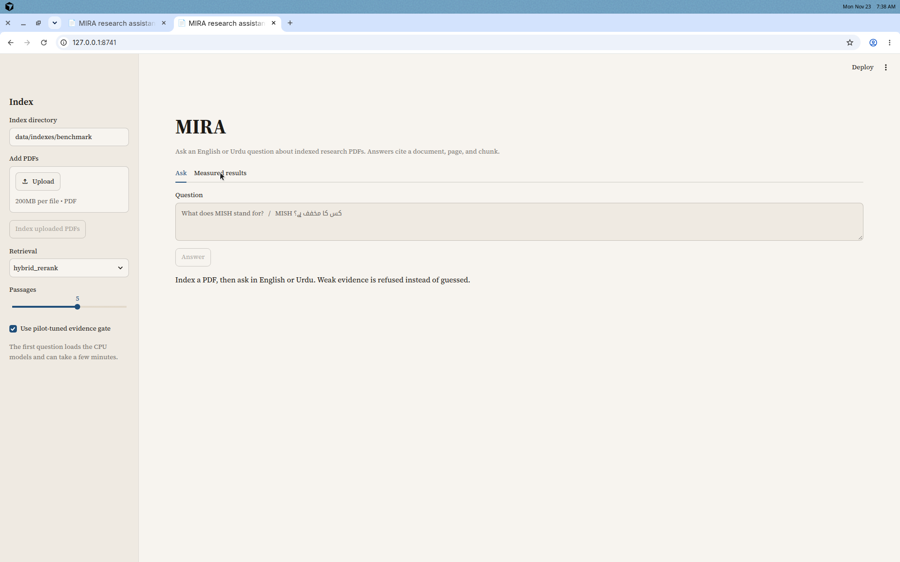
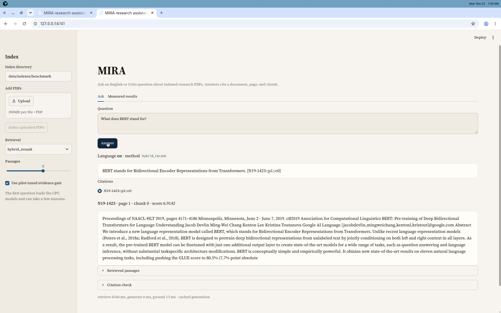
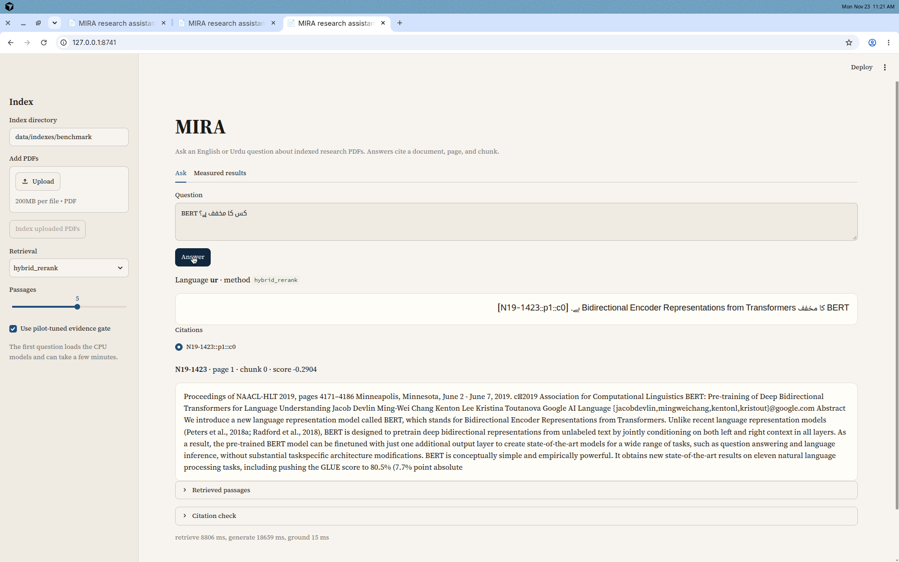
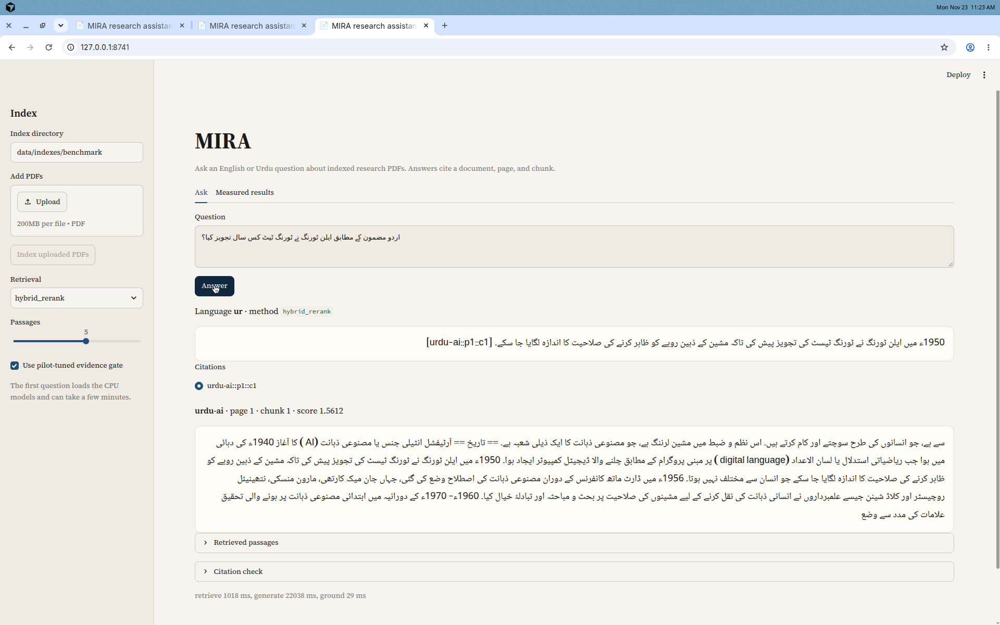

# Multilingual AI Research Assistant

[](https://github.com/Shaiza666/Multilingual-AI-research-assistant-/actions/workflows/ci.yml)

Author: Shaiza Asghar ([Shaiza666](https://github.com/Shaiza666))

MIRA answers questions about research PDFs in English or Urdu. It retrieves a page-aware passage, drafts an answer with a small local instruct model, and keeps a sentence only when that passage supports it. If the evidence is weak, it says the answer is not in the indexed documents.

Everything in the default configuration runs on CPU. No API key is required. An OpenAI-compatible server can be selected with environment variables when one is available.

## What it compares

| Method | What it ranks by |
| --- | --- |
| `bm25` | BM25L keyword overlap after Urdu letter folding |
| `dense` | `intfloat/multilingual-e5-small` cosine similarity in a FAISS inner-product index |
| `hybrid` | Reciprocal rank fusion of BM25L and dense |
| `hybrid_rerank` | Fusion, then the multilingual cross-encoder `mmarco-mMiniLMv2-L12-H384` |
| `hybrid_translate` | For Urdu questions, also fuses BM25L and dense runs of an Urdu-to-English translation |
| `hybrid_translate_rerank` | The translated hybrid list, reranked |

BM25L is used instead of Okapi BM25 because Okapi's IDF is zero when a term appears in about half of a small chunk collection. Documents that contain none of the query terms still receive a zero BM25L score.

## Architecture



Urdu text is stored in Unicode NFKC so Arabic presentation forms extracted from PDFs become ordinary letters. The index folds Arabic kaf/yeh onto the Urdu letters and maps Eastern Arabic digits to ASCII. The text shown to the reader keeps the original letters aside from that compatibility normalisation.

Citations look like `[2103.14460::p1::c0]`: arXiv id, 1-based PDF page, and chunk index on that page. A sentence is kept when at least 35% of its content words occur in a retrieved chunk, or when the multilingual embedding cosine with that chunk is at least 0.82. Both thresholds were fixed before the test run. The evidence gate is separate: its score threshold is chosen on the 8-question pilot split and enabled only when it beats both 0.60 accuracy and the majority-class baseline. The pilot is not part of the reported scores.

## Benchmark

Nine research papers, plus one Urdu encyclopedia article. Three papers state CC BY 4.0 on the PDF (`2103.14460v1`, `2103.14455v1`, `2106.16239v9`). Six are ACL Anthology papers from 2019–2024 (BERT, Sentence-BERT, BART, dense passage retrieval, a parameter-efficient ensembling paper, and an arithmetic paper). The Anthology licenses material published in or after 2016 under CC BY 4.0. The Urdu document is Wikipedia article مصنوعی ذہانت, revision 11740367, under CC BY-SA 4.0. Attribution is in `data/papers/MANIFEST.json` and `data/urdu/artificial-intelligence-ur.txt`.

The test file has 104 questions: 44 English answerable, 44 Urdu translations of those questions, and 8 unanswerable questions in each language. A disjoint pilot of 14 questions sets the evidence gate and is not scored. Urdu items are translations, not a second annotation. Every answerable item has a quotation checked against the cited page. Eight of the test questions are about the Urdu article, including English questions over Urdu text. Details are in [data/qa/README.md](data/qa/README.md).

Retrieval metrics are macro-averages over the 88 answerable questions. Recall@k is the fraction of gold pages in the top k chunks. MRR uses the chunk rank of the first gold page. nDCG@k uses the first visit to each page inside the top k chunks. Token F1 is in the question language, and an abstention on an answerable question scores 0. Semantic score is the cosine of multilingual-e5 embeddings of the final answer and the reference; abstention scores 0. Exact match is the normalised full-string match. Bootstrap intervals are 1,000 resamples of questions. Citation page precision is the fraction of emitted citations whose page is a gold page. A sentence that mostly repeats the question is dropped. If the draft is unusable, the system can show the best retrieved sentence instead; generated-only F1 scores that fallback as 0.

## Models

Local answers use Qwen2.5 Instruct GGUF weights at Q4_K_M. `configs/default.yaml` expects one file per profile under `models/`. English questions use the 1.5B file (`quality`, the default). Urdu questions use the 3B file (`large`). The 0.5B file is the `fast` profile. Each repository publishes that quantisation as a single file, with the lowercase name below.

| Profile | File the config expects | Repository | Direct download |
| --- | --- | --- | --- |
| `fast`, 0.5B | `models/qwen2.5-0.5b-instruct-q4_k_m.gguf` | [Qwen/Qwen2.5-0.5B-Instruct-GGUF](https://huggingface.co/Qwen/Qwen2.5-0.5B-Instruct-GGUF) | [qwen2.5-0.5b-instruct-q4_k_m.gguf](https://huggingface.co/Qwen/Qwen2.5-0.5B-Instruct-GGUF/resolve/main/qwen2.5-0.5b-instruct-q4_k_m.gguf) |
| `quality`, 1.5B default | `models/qwen2.5-1.5b-instruct-q4_k_m.gguf` | [Qwen/Qwen2.5-1.5B-Instruct-GGUF](https://huggingface.co/Qwen/Qwen2.5-1.5B-Instruct-GGUF) | [qwen2.5-1.5b-instruct-q4_k_m.gguf](https://huggingface.co/Qwen/Qwen2.5-1.5B-Instruct-GGUF/resolve/main/qwen2.5-1.5b-instruct-q4_k_m.gguf) |
| `large`, 3B for Urdu | `models/qwen2.5-3b-instruct-q4_k_m.gguf` | [Qwen/Qwen2.5-3B-Instruct-GGUF](https://huggingface.co/Qwen/Qwen2.5-3B-Instruct-GGUF) | [qwen2.5-3b-instruct-q4_k_m.gguf](https://huggingface.co/Qwen/Qwen2.5-3B-Instruct-GGUF/resolve/main/qwen2.5-3b-instruct-q4_k_m.gguf) |

The same configuration also loads these Hugging Face models for retrieval and translation:

- Embeddings: [intfloat/multilingual-e5-small](https://huggingface.co/intfloat/multilingual-e5-small)
- Reranker: [cross-encoder/mmarco-mMiniLMv2-L12-H384-v1](https://huggingface.co/cross-encoder/mmarco-mMiniLMv2-L12-H384-v1)
- English-to-Urdu translation: [Helsinki-NLP/opus-mt-en-ur](https://huggingface.co/Helsinki-NLP/opus-mt-en-ur)
- Urdu-to-English translation, used when an Urdu question is also searched in English: [Helsinki-NLP/opus-mt-ur-en](https://huggingface.co/Helsinki-NLP/opus-mt-ur-en)

One command saves the three GGUF files into `models/` under the names above, and caches the embedding, reranker, and translation models:

```bash
python scripts/download_models.py
```

## Setup

```bash
python3 -m venv .venv
source .venv/bin/activate
pip install -U pip
pip install torch --index-url https://download.pytorch.org/whl/cpu
pip install -r requirements.txt
export PYTHONPATH=src
python scripts/download_models.py
python scripts/download_papers.py
python -m mira.cli ingest data/papers/pdf --index data/indexes/benchmark
```

`download_papers.py` refuses a PDF that does not state CC BY 4.0 or CC BY-SA 4.0. PDFs are not committed; the extracted text, the manifest, and the question files are.

## Commands

```bash
python -m mira.cli ask "What does MISH stand for?" --method hybrid_rerank
python -m mira.cli ask "MISH کس کا مخفف ہے؟" --method hybrid_rerank
python -m mira.cli evaluate --profiles fast quality large --out results
pytest -q
streamlit run src/mira/app.py --server.port 8741
```

`make install`, `make download-models`, `make download-papers`, `make ingest`, `make evaluate`, `make test`, `make lint`, and `make app` wrap the same steps.

## Tests

The offline suite skips tests marked `models`. Those tests need GGUF weights, a Hugging Face download, or network access. CI runs this suite on CPU and does not download models:

```bash
PYTHONPATH=src pytest -q -m "not models"
ruff check src tests
```

The full suite also runs any tests marked `models`:

```bash
PYTHONPATH=src pytest -q
```

`make test` runs the full suite. `make lint` runs the same ruff check.

To use an OpenAI-compatible server instead of the local GGUF model:

```bash
export MIRA_LLM_BACKEND=openai
export OPENAI_BASE_URL=http://127.0.0.1:8080/v1
export OPENAI_API_KEY=local
export OPENAI_MODEL=name-served-by-that-server
```

`MIRA_LLM_BACKEND=transformers` loads `Qwen/Qwen2.5-0.5B-Instruct` in PyTorch. The default is `local-gguf`.

The Streamlit app accepts PDF uploads, answers in English or Urdu, and shows the cited chunk when a citation is selected. The second tab reads `results/` after an evaluation.

A one-page original sample note, in English and Urdu, is at `data/samples/sample-note.pdf`. It is not part of the scored benchmark.

## Measured results

Two runs of the same 104-question file are compared below. Both use the 14-question pilot only to set the evidence gate. The gate rule did not change: only hybrid reranking separates, at threshold −3.24, with pilot accuracy 1.0. Hardware for both runs: Intel Xeon, 4 logical CPUs at 2.4 GHz, 15.63 GiB RAM, Python 3.12.3, PyTorch 2.15.0+cpu. The later run had no exceptions.

The later run repairs the Urdu article after PDF extraction. NFKC folds Arabic presentation forms, and four extraction substitutions restore Urdu letters that the font map had replaced (`ڻ` to `ٹ`, the lam-alef clicks, and `Ȉ` to `ۂ`). Parentheses are swapped only in mostly Arabic text. The index was rebuilt: 658 chunks. Page Recall@5 for hybrid reranking is still 0.875 overall and 0.875 on the 8 questions about that article.

Urdu questions are answered by Qwen2.5 3B Instruct Q4. English questions stay on Qwen2.5 1.5B Instruct Q4. The prompt asks for one short sentence and tells the model to keep names and numbers in Latin script. A sentence that already contains Urdu words is kept even when the Latin terms are longer. If the draft is still English, `opus-mt-en-ur` translates it with those terms masked and then restored. On this run, 12 of the 52 Urdu questions still kept the English sentence because that translation failed the name check. A separate NLLB model was not part of this measured run.

Raw token F1 is the same whitespace overlap as before. Normalized F1 splits digits from attached Urdu letters, so `1950ء` can match `1950`, and it drops citations and the bilingual frame. `F1 either` is the better normalized F1 against the question-language reference or the English reference. Raw F1 is still reported.

### Urdu answers, hybrid reranking, 52 Urdu questions

| | raw F1 | 95% CI | normalized F1 | semantic | exact match | normalized EM | citation page precision | abstention accuracy |
| --- | ---: | --- | ---: | ---: | ---: | ---: | ---: | ---: |
| Previous run, 1.5B for every question | 0.074 | 0.049–0.099 | — | 0.787 | 0.000 | — | 0.585 | 0.923 |
| This run, 3B for Urdu questions | 0.125 | 0.079–0.179 | 0.183 | 0.779 | 0.000 | 0.000 | 0.525 | 0.904 |

The raw-F1 intervals overlap. The point estimate rose from 0.074 to 0.125. Normalized F1 on this run is 0.183 (95% CI 0.122–0.255). `F1 either` is 0.219 (95% CI 0.158–0.287). Semantic cosine moved from 0.787 to 0.779. Exact match is still 0.000: the references are short phrases and the answers are sentences. Citation page precision fell from 0.585 to 0.525. Answerable coverage is 0.909, and 0.875 of Urdu unanswerable questions are refused.

On the 8 questions about the Urdu article, raw F1 moved from 0.105 (95% CI 0.051–0.160) to 0.216 (95% CI 0.111–0.337). Normalized F1 there is 0.338 (95% CI 0.198–0.484). Citation page precision on that slice is 1.000. Recall@5 is unchanged at 0.875, so the gain is in the text and the answer, not in finding a different page.

Two answers from this run: `BERT کا مخفف Bidirectional Encoder Representations from Transformers ہے۔` with citation `N19-1423::p1::c0` (raw F1 0.556, normalized F1 0.714), and `1950ء میں ایلن ٹورنگ نے ٹورنگ ٹیسٹ کی تجویز پیش کی۔` with citation `urdu-ai::p1::c1`. The second contains the gold year, but raw F1 is 0.000 because `1950ء` is one whitespace token. Normalized F1 treats the year as `1950`.

### All 104 questions, hybrid reranking

| | raw F1 | 95% CI | English F1 | Urdu F1 | semantic | citation page precision |
| --- | ---: | --- | ---: | ---: | ---: | ---: |
| Previous run | 0.217 | 0.174–0.264 | 0.360 | 0.074 | 0.817 | 0.669 |
| This run | 0.228 | 0.184–0.272 | 0.331 | 0.125 | 0.808 | 0.646 |

English raw F1 is lower (0.331, 95% CI 0.264–0.392) after the shorter prompt. Normalized exact match on all 104 questions is 0.023, and on English questions it is 0.045. Raw exact match remains 0.000.

Urdu raw F1 by retriever on this run: BM25L 0.060, dense 0.130, hybrid 0.074, hybrid rerank 0.125, translated hybrid 0.069, translated hybrid plus rerank 0.114. Dense retrieval has the higher Urdu semantic score, 0.851 against 0.779 after reranking.

### Latency on this run

Generation times below are from the uncached pass. English questions use the 1.5B model and Urdu questions use the 3B model. Hybrid reranking, 84 generations:

| | median |
| --- | ---: |
| Retrieve | 564 ms |
| Generate, English | 6.45 s |
| Generate, Urdu | 14.7 s |
| End to end | 8.12 s |

The Urdu model costs about 8.3 seconds more per generated answer than the English model on this machine. The first load of each file is not in those medians; the 1.5B warmup was 0.5 seconds because the file was already in the page cache. `hybrid_translate` English generate times in `results/latency.csv` are near 0.1 ms because those English prompts matched an earlier method and were read from the cache. They are not a generation speed.

Full tables are in [results/RESULTS.md](results/RESULTS.md).











## Limitations


- Urdu questions are translations. Raw Urdu F1 on this run is 0.125, and the 95% interval still overlaps the previous run. Twelve Urdu answers kept an English sentence because `opus-mt-en-ur` failed the name check. A separate NLLB model was not measured.
- Raw exact match is 0.000. Normalized exact match is 0.023. The drafts are sentences around a short reference.
- Gold pages are the annotated pages. A later page that repeats the fact still counts as a citation miss.
- The evidence gate is fit on 14 pilot questions. Only the reranker separated answerable from unanswerable items, so the other methods do not abstain before generation. Hybrid retrieval's unanswerable abstention rate is 0.000.
- The cross-encoder was not trained on Urdu. Its Urdu Recall@5 of 0.818 is specific to this set.
- The Urdu article slice has 8 questions. English questions over that article are still often refused.
- Generation medians for `hybrid_translate` in the raw timing file are near zero because English prompts matched an earlier method and were cached. Those figures are not used above.

## Further work

- Write Urdu questions that are not translations, against papers that are themselves in Urdu.
- Replace the support check with a small multilingual entailment model if it stays fast on CPU.
- Sweep the reranker threshold on a larger pilot and publish the curve.
- Cache the translation model so Urdu post-editing does not reload it for every question.

## Licence

The code is released under the MIT licence, copyright Shaiza Asghar. The Noto Naskh Arabic font in `src/mira/assets/fonts/` is under the SIL Open Font License 1.1. Paper and article licences are recorded in `data/papers/MANIFEST.json` and `data/urdu/artificial-intelligence-ur.txt`.
