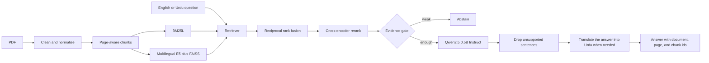
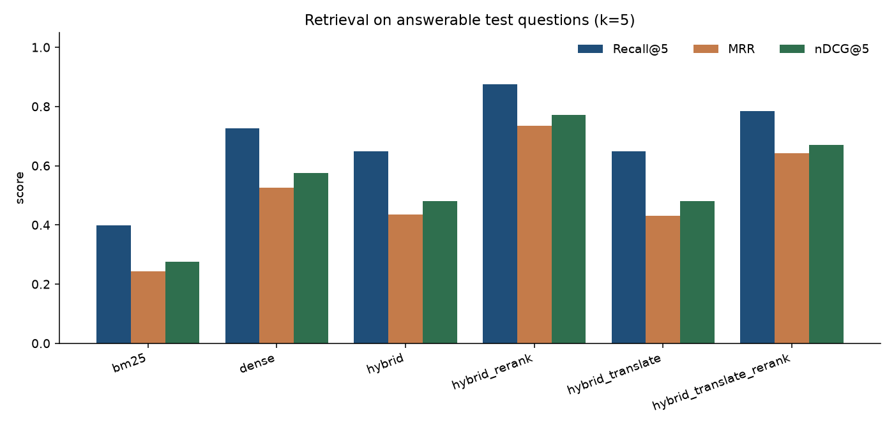
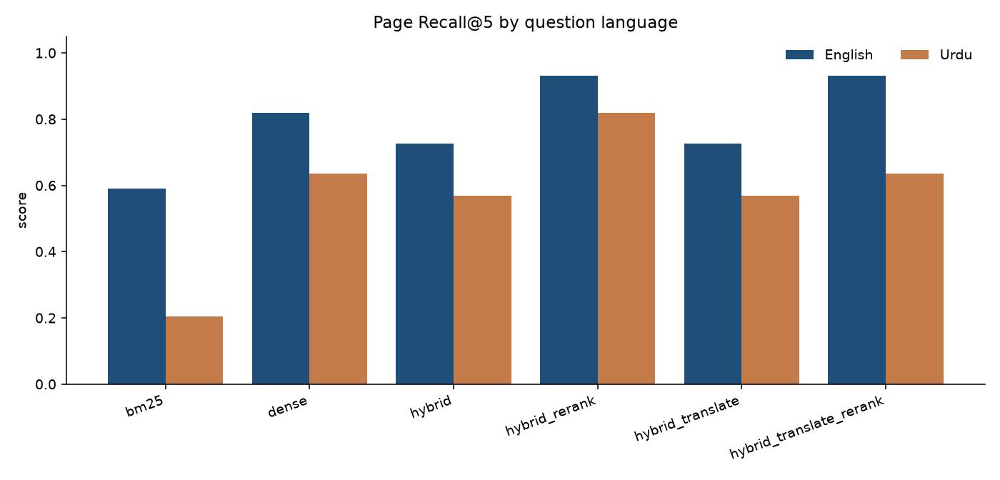
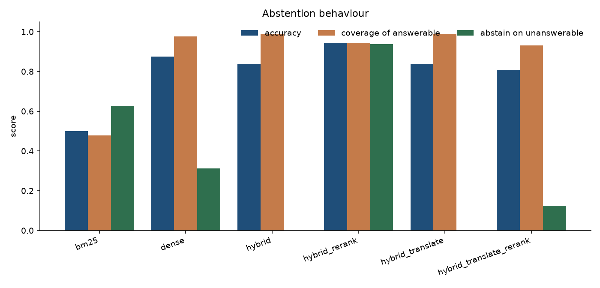
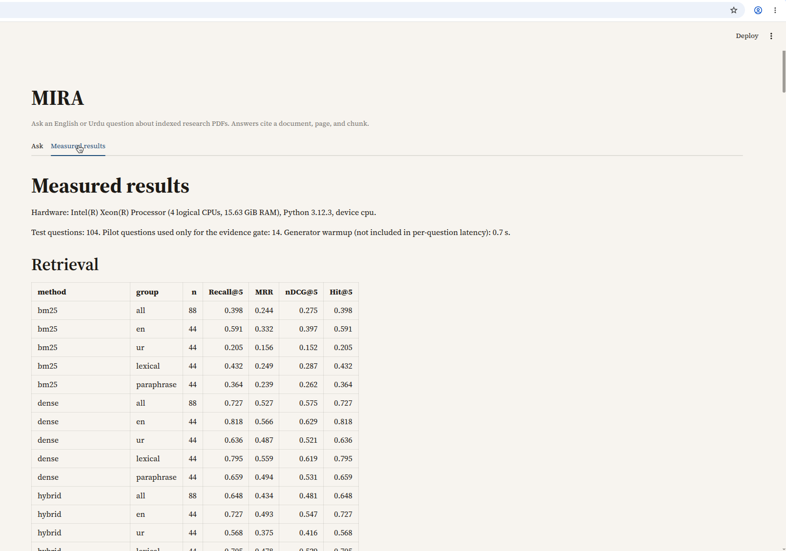

# Multilingual AI Research Assistant

Author: Shaiza Asghar ([Shaiza666](https://github.com/Shaiza666))

MIRA answers questions about research PDFs in English or Urdu. It retrieves a page-aware passage, drafts an answer with a small local instruct model, and keeps a sentence only when that passage supports it. If the evidence is weak, it says the answer is not in the indexed documents.

Everything in the default configuration runs on CPU. No API key is required. An OpenAI-compatible server can be selected with environment variables when one is available.

## What it compares

| Method | What it ranks by |
| --- | --- |
| `bm25` | BM25L keyword overlap after Urdu letter folding |
| `dense` | `intfloat/multilingual-e5-small` cosine similarity in a FAISS inner-product index |
| `hybrid` | Reciprocal rank fusion of BM25L and dense |
| `hybrid_rerank` | Fusion, then the multilingual cross-encoder `mmarco-mMiniLMv2-L12-H384` |
| `hybrid_translate` | For Urdu questions, also fuses BM25L and dense runs of an Urdu-to-English translation |
| `hybrid_translate_rerank` | The translated hybrid list, reranked |

BM25L is used instead of Okapi BM25 because Okapi's IDF is zero when a term appears in about half of a small chunk collection. Documents that contain none of the query terms still receive a zero BM25L score.

## Architecture



Urdu text is stored in Unicode NFKC so Arabic presentation forms extracted from PDFs become ordinary letters. The index folds Arabic kaf/yeh onto the Urdu letters and maps Eastern Arabic digits to ASCII. The text shown to the reader keeps the original letters aside from that compatibility normalisation.

Citations look like `[2103.14460::p1::c0]`: arXiv id, 1-based PDF page, and chunk index on that page. A sentence is kept when at least 35% of its content words occur in a retrieved chunk, or when the multilingual embedding cosine with that chunk is at least 0.82. Both thresholds were fixed before the test run. The evidence gate is separate: its score threshold is chosen on the 8-question pilot split and enabled only when it beats both 0.60 accuracy and the majority-class baseline. The pilot is not part of the reported scores.

## Benchmark

Nine research papers, plus one Urdu encyclopedia article. Three papers state CC BY 4.0 on the PDF (`2103.14460v1`, `2103.14455v1`, `2106.16239v9`). Six are ACL Anthology papers from 2019–2024 (BERT, Sentence-BERT, BART, dense passage retrieval, a parameter-efficient ensembling paper, and an arithmetic paper). The Anthology licenses material published in or after 2016 under CC BY 4.0. The Urdu document is Wikipedia article مصنوعی ذہانت, revision 11740367, under CC BY-SA 4.0. Attribution is in `data/papers/MANIFEST.json` and `data/urdu/artificial-intelligence-ur.txt`.

The test file has 104 questions: 44 English answerable, 44 Urdu translations of those questions, and 8 unanswerable questions in each language. A disjoint pilot of 14 questions sets the evidence gate and is not scored. Urdu items are translations, not a second annotation. Every answerable item has a quotation checked against the cited page. Eight of the test questions are about the Urdu article, including English questions over Urdu text. Details are in [data/qa/README.md](data/qa/README.md).

Retrieval metrics are macro-averages over the 88 answerable questions. Recall@k is the fraction of gold pages in the top k chunks. MRR uses the chunk rank of the first gold page. nDCG@k uses the first visit to each page inside the top k chunks. Token F1 is in the question language, and an abstention on an answerable question scores 0. Semantic score is the cosine of multilingual-e5 embeddings of the final answer and the reference; abstention scores 0. Exact match is the normalised full-string match. Bootstrap intervals are 1,000 resamples of questions. Citation page precision is the fraction of emitted citations whose page is a gold page. A sentence that mostly repeats the question is dropped. If the draft is unusable, the system can show the best retrieved sentence instead; generated-only F1 scores that fallback as 0.

## Setup

```bash
python3 -m venv .venv
source .venv/bin/activate
pip install -U pip
pip install torch --index-url https://download.pytorch.org/whl/cpu
pip install -r requirements.txt
export PYTHONPATH=src
python scripts/download_models.py
python scripts/download_papers.py
python -m mira.cli ingest data/papers/pdf --index data/indexes/benchmark
```

`download_papers.py` refuses a PDF that does not state CC BY 4.0 or CC BY-SA 4.0. PDFs are not committed; the extracted text, the manifest, and the question files are.

## Commands

```bash
python -m mira.cli ask "What does MISH stand for?" --method hybrid_rerank
python -m mira.cli ask "MISH کس کا مخفف ہے؟" --method hybrid_rerank
python -m mira.cli evaluate --profiles fast quality large --out results
pytest
streamlit run src/mira/app.py --server.port 8741
```

`make install`, `make download-models`, `make download-papers`, `make ingest`, `make evaluate`, `make test`, and `make app` wrap the same steps.

To use an OpenAI-compatible server instead of the local GGUF model:

```bash
export MIRA_LLM_BACKEND=openai
export OPENAI_BASE_URL=http://127.0.0.1:8080/v1
export OPENAI_API_KEY=local
export OPENAI_MODEL=name-served-by-that-server
```

`MIRA_LLM_BACKEND=transformers` loads `Qwen/Qwen2.5-0.5B-Instruct` in PyTorch. The default is `local-gguf`.

The Streamlit app accepts PDF uploads, answers in English or Urdu, and shows the cited chunk when a citation is selected. The second tab reads `results/` after an evaluation.

A one-page original sample note, in English and Urdu, is at `data/samples/sample-note.pdf`. It is not part of the scored benchmark.

## Measured results

Two measured runs are reported. They are not the same question set, so the second is not a paired improvement on the first.

The earlier run used 3 papers and 32 test questions, Qwen2.5 0.5B, and a gate that sat on the lowest separable pilot score. Its best token F1 was 0.261 (hybrid). Hybrid plus reranking had Recall@5 0.917 but F1 0.184, answerable coverage 0.625, and citation page precision 0.144. Exact match was 0.000.

The current run uses 9 papers, one Urdu article, 104 test questions, and 14 pilot questions. The index has 658 chunks. The gate uses the midpoint of a clean pilot gap, a repeated question is dropped, and a citation prefers the best-ranked supporting chunk. Hardware: Intel Xeon, 4 logical CPUs at 2.4 GHz, 15.63 GiB RAM, Python 3.12.3, PyTorch 2.15.0+cpu. No question raised an exception.

### Retrieval

95% bootstrap intervals are on the all-question Recall@5.

| method | Recall@5 | 95% CI | English | Urdu | MRR | nDCG@5 |
| --- | ---: | --- | ---: | ---: | ---: | ---: |
| bm25 | 0.398 | 0.307–0.511 | 0.591 | 0.205 | 0.244 | 0.275 |
| dense | 0.727 | 0.636–0.818 | 0.818 | 0.636 | 0.527 | 0.575 |
| hybrid | 0.648 | 0.545–0.750 | 0.727 | 0.568 | 0.434 | 0.481 |
| hybrid_rerank | 0.875 | 0.807–0.943 | 0.932 | 0.818 | 0.734 | 0.772 |
| hybrid_translate | 0.648 | 0.557–0.750 | 0.727 | 0.568 | 0.431 | 0.480 |
| hybrid_translate_rerank | 0.784 | 0.693–0.864 | 0.932 | 0.636 | 0.641 | 0.670 |





Hybrid plus reranking is the best retriever. English Recall@5 ties it with translated-and-reranked hybrid at 0.932. Urdu Recall@5 is 0.818 after reranking, 0.636 for dense retrieval, and 0.205 for BM25L. On the 8 questions about the Urdu article, hybrid plus reranking has Recall@5 0.875, so keyword search is no longer the only way to hit Urdu text, but BM25L does reach 0.500 there, against 0.205 on Urdu questions overall. Paraphrase Recall@5 is 0.364 for BM25L, 0.659 for dense retrieval, and 0.841 after reranking. Urdu-to-English query translation does not beat reranking the original question (Urdu Recall@5 0.568 versus 0.818).

Only the reranker had a clean gap on the 14-question pilot, so only that gate is enabled. Its threshold is −3.24, the midpoint between the strongest unanswerable pilot logit and the weakest answerable one. On the test set that gate keeps answerable coverage at 0.943 and abstains on 0.938 of unanswerable questions.

### Answers with Qwen2.5 1.5B

This is the default `quality` profile. Exact match is 0.000 for every method: the references are short facts, and the drafts add framing words. Semantic score is the multilingual embedding cosine; abstention scores 0. Token F1 still scores an abstention on an answerable question as 0.

| method | F1 | 95% CI | English | Urdu | semantic | generated-only F1 | citation page precision | abstention accuracy |
| --- | ---: | --- | ---: | ---: | ---: | ---: | ---: | ---: |
| bm25 | 0.110 | 0.072–0.154 | 0.198 | 0.022 | 0.408 | 0.110 | 0.329 | 0.500 |
| dense | 0.201 | 0.157–0.246 | 0.319 | 0.084 | 0.838 | 0.183 | 0.471 | 0.875 |
| hybrid | 0.189 | 0.148–0.233 | 0.305 | 0.072 | 0.839 | 0.171 | 0.385 | 0.837 |
| hybrid_rerank | 0.217 | 0.174–0.264 | 0.360 | 0.074 | 0.817 | 0.194 | 0.669 | 0.942 |
| hybrid_translate | 0.180 | 0.139–0.226 | 0.305 | 0.056 | 0.839 | 0.163 | 0.397 | 0.837 |
| hybrid_translate_rerank | 0.205 | 0.158–0.254 | 0.362 | 0.048 | 0.799 | 0.187 | 0.571 | 0.808 |




On this set the best retriever is also the best end-to-end system. Hybrid plus reranking has the highest F1 (0.217), the highest abstention accuracy (0.942), and citation page precision 0.669. On the earlier 32-question run that same method's citation page precision was 0.144, because the citation was attached to the chunk with the largest overlap rather than the best-ranked supporting chunk, and the gate refused too many answerable questions (coverage 0.625). Generated-only F1 for hybrid plus reranking is 0.194, so the retrieved-sentence fallback adds a small amount on top of the draft.

Urdu token F1 stays low (0.074 for the best retriever, 0.084 for dense retrieval). The semantic score on those same Urdu answers is 0.787 for hybrid plus reranking. Many Urdu answers keep the English source sentence inside an Urdu frame when the translation model does not preserve names and numbers, so token overlap with a translated reference is small while the embedding still sees the fact. An English success is "BERT stands for Bidirectional Encoder Representations from Transformers" with citation `N19-1423::p1::c0` (token F1 0.588, semantic cosine 0.900). The unanswerable photosynthesis question is refused.

English questions about the Urdu article are not solved reliably: the Turing-test year question was refused under hybrid plus reranking. On the 8-question Urdu-article slice, that method's Recall@5 is 0.875, token F1 is 0.105, and citation page precision is 1.000.

### Model size

Same retrieval, full 104-question answers. The scoring pass reused cached drafts, so the generate column in `results/latency.csv` (about 0.1 ms) is a cache hit and is not model speed. Retrieval medians in that file are real: BM25L 0.9 ms, dense 8.3 ms, hybrid 9.8 ms, hybrid plus reranking 523 ms.

A separate cold sample, cache disabled, used hybrid plus reranking on three questions that actually called the model (BERT expansion, MISH expansion, the Urdu MISH question) after one short warmup prompt. The COVID-19 question was refused by the gate and did not call the model.

| profile | parameters | F1 | English F1 | Urdu F1 | semantic | citation page precision | cold generate median (n=3) |
| --- | --- | ---: | ---: | ---: | ---: | ---: | ---: |
| fast | 0.5B Q4 | 0.159 | 0.279 | 0.039 | 0.806 | 0.623 | 3.69 s |
| quality | 1.5B Q4 | 0.217 | 0.360 | 0.074 | 0.817 | 0.669 | 5.92 s |
| large | 3B Q4 | 0.203 | 0.292 | 0.113 | 0.814 | 0.620 | 11.0 s |

The three 0.5B calls took 4.65 s, 3.36 s, and 3.69 s. The three 1.5B calls took 5.92 s, 4.87 s, and 77.9 s. The 77.9 s call is the Urdu question while the Streamlit process was also loading models; the other two 1.5B calls were 4.9–5.9 s. The three 3B calls took 11.4 s, 9.31 s, and 11.0 s. The first 3B call after loading that file, a one-line warmup, took 84.1 s and is not in the median. On this sample the 0.5B and 1.5B English answers were "BERT stands for Bidirectional Encoder Representations from Transformers" and "MISH stands for Multi-Index Semantic Hashing". The 3B Urdu answer was "MISH کا مخفف Semantic Hashing ہے", which drops "Multi-Index".


1.5B has the best overall F1. 3B has the best Urdu token F1 (0.113) and its cold sample median is 11.0 s. 0.5B is the fast option. Full tables are in [results/RESULTS.md](results/RESULTS.md). Row-level outputs are in `results/predictions.jsonl`.

Screenshots of the running app:




## Limitations

- Urdu questions are translations. Token F1 in Urdu stays under 0.12 even with the 3B model. The Marian English-to-Urdu model often fails to keep technical names, so many answers stay bilingual rather than fully Urdu.
- Exact match is 0. The drafts add words around a short reference, which semantic cosine counts and exact match does not.
- Gold pages are the annotated pages. A later page that repeats the fact still counts as a citation miss.
- The evidence gate is fit on 14 pilot questions. Only the reranker separated answerable from unanswerable items, so the other methods do not abstain before generation. Hybrid retrieval's unanswerable abstention rate is 0.000.
- The cross-encoder was not trained on Urdu. Its Urdu Recall@5 of 0.818 is specific to this set.
- The Urdu article slice has 8 questions. English questions over that article are still often refused.
- Generation medians for `hybrid_translate` in the raw timing file are near zero because English prompts matched an earlier method and were cached. Those figures are not used above.

## Further work

- Write Urdu questions that are not translations, against papers that are themselves in Urdu.
- Replace the support check with a small multilingual entailment model if it stays fast on CPU.
- Sweep the reranker threshold on a larger pilot and publish the curve.
- Cache the translation model so Urdu post-editing does not reload it for every question.

## Licence

The code is released under the MIT licence, copyright Shaiza Asghar. The Noto Naskh Arabic font in `src/mira/assets/fonts/` is under the SIL Open Font License 1.1. Paper and article licences are recorded in `data/papers/MANIFEST.json` and `data/urdu/artificial-intelligence-ur.txt`.
